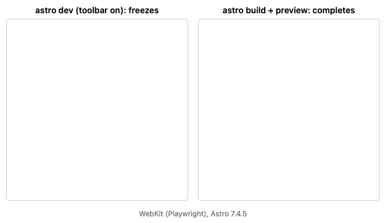

# Astro's dev toolbar freezes SVG animations in Safari

An SVG shown through `` that animates with CSS stops partway through in Safari under
`astro dev`. It plays to the end in a build, with the toolbar off, and in Chromium.



## Reproduce

```sh
pnpm install
pnpm dev
```

Open http://localhost:4321/ in Safari. The ring should draw itself in one second and "OK" should
fade in. Instead the ring stops about a quarter of the way round, and "OK" never shows.

It completes in each of these cases:

- `ASTRO_DEV_TOOLBAR=off pnpm dev`, which turns the toolbar off in `astro.config.mjs`;
- `pnpm build && pnpm preview`;
- any Chromium browser.

Tested with Astro 7.4.5, Safari on macOS and Playwright's WebKit.
